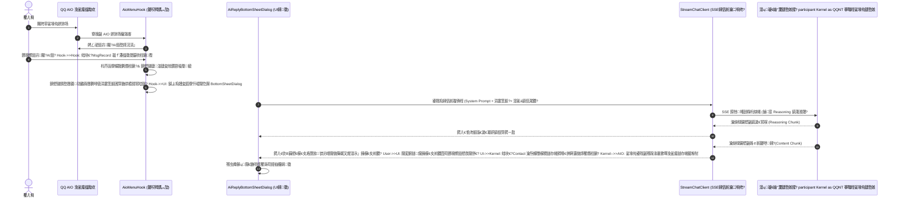

# QAI (QQ AI Reply Assistant)

> 娣卞害闆嗘垚浜?QQNT 鍘熺敓浼氳瘽鐣岄潰鐨勯珮鎬ц兘銆佸妯℃€?AI 鏅鸿兘鍥炲涓庝笂涓嬫枃浼氳瘽杈呭姪 Xposed / LSPosed 妯″潡銆?
[](LICENSE)
[](https://developer.android.com)
[](https://im.qq.com)
[](https://github.com/LSPosed/LSPosed)
[](https://github.com)

---

## 鐩綍

- [椤圭洰绠€浠媇(#椤圭洰绠€浠?
- [鏍稿績鐗规€(#鏍稿績鐗规€?
- [浜や簰娴佺▼涓庢灦鏋勮璁(#浜や簰娴佺▼涓庢灦鏋勮璁?
- [蹇€熷紑濮媇(#蹇€熷紑濮?
  - [杩愯鐜瑕佹眰](#杩愯鐜瑕佹眰)
  - [涓嬭浇涓庢縺娲籡(#涓嬭浇涓庢縺娲?
  - [婧愮爜缂栬瘧鎵撳寘](#婧愮爜缂栬瘧鎵撳寘)
- [鍔熻兘涓庨厤缃瑙(#鍔熻兘涓庨厤缃瑙?
  - [鏈嶅姟鍟嗙敓鎬佷笌妯″瀷鎺ュ叆](#鏈嶅姟鍟嗙敓鎬佷笌妯″瀷鎺ュ叆)
  - [涓婁笅鏂囦笌澶氭ā鎬佽瑙夋函婧怾(#涓婁笅鏂囦笌澶氭ā鎬佽瑙夋函婧?
  - [鑷€傚簲澶氶」鍊欓€夊洖澶峕(#鑷€傚簲澶氶」鍊欓€夊洖澶?
  - [鎬濈淮閾撅紙CoT锛夋帹鐞嗘姌鍙燷(#鎬濈淮閾綾ot鎺ㄧ悊鎶樺彔)
  - [QQ 鍘熺敓 QUI 瑙勮寖閫傞厤](#qq-鍘熺敓-qui-瑙勮寖閫傞厤)
- [甯歌闂涓庢晠闅滄帓鏌(#甯歌闂涓庢晠闅滄帓鏌?
- [瀹夊叏涓庡厤璐ｅ０鏄嶿(#瀹夊叏涓庡厤璐ｅ０鏄?
- [寮€婧愬崗璁甝(#寮€婧愬崗璁?

---

## 椤圭洰绠€浠?
**QAI** 鏄竴娆鹃潰鍚戠幇浠ｅ寲绉诲姩绔嵆鏃堕€氳鐢熸€侊紙閽堝 QQNT 鏋舵瀯锛夌殑楂橀樁 AI 杈呭姪鎻掍欢銆傛ā鍧楅€氳繃杞婚噺绾?Native / Java 灞?Hook 娣卞害鍒囧叆 QQ 瀹樻柟 AIO锛圓ll-In-One锛変細璇濆紩鎿庝笌娑堟伅娓叉煋娴佹按绾匡紝涓嶄粎鑳戒粠浼氳瘽瑙嗗浘闀挎寜蹇嵎鍛煎嚭娴佸紡 AI 鍥炲闈㈡澘锛屾洿鑳界┛閫忓簳灞傚師鐢熸暟鎹ā鍨嬶紙`MsgRecord`锛夛紝瀹炵幇澶嶆潅瀵屽獟浣撴秷鎭摼瑙ｆ瀽銆佹湰鍦伴珮娓呭浘鐗囧妯℃€佹彁鍙栥€佸紩鐢ㄥ叧绯昏嚜鍔ㄨ法娑堟伅杩芥函浠ュ強缁曡繃杈撳叆妗嗙殑鍐呮牳闈欓粯鐩存帴鎶曢€掋€?
---

## 鏍稿績鐗规€?
- 馃幆 **娣卞害鍘熺敓闆嗘垚**锛?  - 浼氳瘽娑堟伅闀挎寜姘旀场鑿滃崟鏃犵紳娉ㄥ叆銆岃闂?AI銆嶅叆鍙ｏ紱
  - 璁剧疆椤电洿鎺ヨ瀺鍏?QQ 鍘熺敓璁剧疆鍒楄〃鍗＄墖浣撶郴锛屾敮鎸佹殫榛戞ā寮忚嚜閫傚簲銆?- 馃憗锔?**鍏ㄩ摼璺妯℃€佽瑙夋劅鐭?*锛?  - 鑷姩绌块€忓唴鏍告彁鍙栧綋鍓嶉€変腑娑堟伅銆佸墠搴忓巻鍙叉秷鎭強寮曠敤婧愭秷鎭殑鏈湴纾佺洏鍥剧墖锛堝師鍥?缂╃暐鍥捐矾寰勶級锛?  - 灏嗗妯℃€佹暟鎹紪鐮佸苟鑱氬悎閫佸叆澶氭ā鎬佸ぇ妯″瀷锛堝 Gemini銆丟PT-4o銆丆laude 3.5锛夛紝璁╁ぇ妯″瀷鐪熸鈥滅湅瑙佲€濆墠搴忓浘鐗囥€?- 馃挰 **澶嶆潅娑堟伅閾剧簿鍑嗚В鏋?*锛?  - 瑕嗙洊鏂囨湰銆佽闊宠瘑鍒€佺郴缁熻〃鎯呬笌鍟嗗煄琛ㄦ儏鍖呫€佸悎骞惰浆鍙戝崱鐗囷紙`MultiForwardMsgElement`锛夈€丄rk 鍗＄墖锛圝SON 娣卞害鎻愬彇锛夈€佺粨鏋勫寲 XML 鍗＄墖浠ュ強鏂囦欢/瑙嗛锛?  - 鏃堕棿绾挎椂搴忓崰浣嶄繚鎶わ紝纭繚鍘嗗彶鑳屾櫙鍥犳灉鍏崇郴涓嶈捀鍙戙€?- 馃幁 **鍦烘櫙鎰熺煡涓庘€滀綘鎴戜粬鈥濅富浣撹瘑鍒?*锛?  - 鍔ㄦ€佽瘑鍒細璇濆満鏅紙缇よ亰銆侀閬撱€佸ソ鍙嬬鑱婏級涓庣兢鍚嶇О锛?  - 涓ユ牸鍖哄垎鈥滄垜鈥濅笌浠栦汉鐨勫彂瑷€绔嬪満锛岄伩鍏嶅ぇ妯″瀷娣锋穯鍥炲涓讳綋銆?- 鈿?**鑷€傚簲澶氶」鍊欓€夊洖澶?*锛?  - 鏀寔鍗曟潯绮剧偧鍥炲涓庡椤瑰€欓€夋ā寮忥紱
  - 绐佺牬闈欐€佹潯鏁伴檺鍒讹紝鏍规嵁娴佸紡杈撳嚭鑷€傚簲鍔ㄦ€佸鍒犲€欓€夊崱鐗囷紝鏀寔涓€閿崟閫夋搷浣溿€?- 馃殌 **QQNT 搴曞眰鍐呮牳闈欓粯鐩存帴鎶曢€?*锛?  - 绌块€?`Contact` 涓庡簳灞傛秷鎭湇鍔★紝鏀寔涓€閿彂閫佺洿鎺ユ姇閫掑悗鍙帮紝褰诲簳鍏嶅幓澶嶅埗/濉叆/鐐瑰嚮鍙戦€佺瓑绻佺悙浜や簰锛?  - 鏀寔鑱斿姩鍘熷娑堟伅鐨勮嚜鍔ㄥ紩鐢ㄥ洖澶嶃€?- 馃 **娣卞害鎬濊€冩€濈淮閾撅紙CoT锛夋敮鎸?*锛?  - 娣卞害鍏煎 DeepSeek R1銆丟emini 鎬濊€冩ā鍨嬶紱
  - 鍏峰鎬濊€冧腑鍔ㄦ€佹寚绀恒€佽嚜鍔ㄨ€楁椂缁熻銆佸畬鎴愭椂骞虫粦鎶樺彔鍙婃寜闇€绂佺敤鎬濊€冩満鍒躲€?- 馃帹 **瀵归綈 QQ 瀹樻柟 QUI 瑙嗚瑙勮寖**锛?  - 鍏ㄩ潰閲囩敤娌夋蹈寮忓叏灞忕┛閫忓崐閫忔槑椤舵爮锛?  - 鎷掔粷绮楃硻绾粦锛屼弗鏍煎榻愭繁鑹叉ā寮忓眰娆＄伆闃朵綋绯伙紙`#191919` / `#242424`锛夛紱
  - 瀹氬埗鏃犲垏瑙掗槻瑁佸壀楂樺搧璐ㄦ粦鍧?Thumb锛屽交搴曠Щ闄ょ郴缁熺矖绯欑殑渚ц竟鎷栧姩鏉°€?
---

## 浜や簰娴佺▼涓庢灦鏋勮璁?
涓嬪浘灞曠ず浜嗙敤鎴峰湪 QQ 鑱婂ぉ鐣岄潰闀挎寜瑙﹀彂 QAI 鍒版渶缁堢敓鎴愬苟鎶曢€掓秷鎭殑绔埌绔妧鏈摼璺細



---

## 蹇€熷紑濮?
### 杩愯鐜瑕佹眰

- **鎿嶄綔绯荤粺**锛欰ndroid 8.0 (API Level 26) 鍙婃洿楂樼増鏈紱
- **Root 鏂规涓庢鏋?*锛氬凡瀹夎骞舵縺娲荤殑 **LSPosed**锛堟帹鑽?Zygisk 妯″紡锛夛紱
- **瀹夸富搴旂敤**锛歈Q 瀹樻柟瀹㈡埛绔紙鏋舵瀯鏀寔 QQNT 8.9.x 鑷?9.x+ 鍏ㄧ郴鏂扮増鏈級銆?
### 涓嬭浇涓庢縺娲?
1. 鍓嶅線 GitHub [Releases](https://github.com/MeiYongAI/QAI/releases) 椤甸潰涓嬭浇鏈€鏂扮殑 `app-release.apk`锛?2. 瀹夎 APK 鑷虫墜鏈鸿澶囷紱
3. 鎵撳紑 **LSPosed Manager**锛屽湪妯″潡鍒楄〃涓惎鐢?**QAI** 妯″潡锛?4. 鍦ㄤ綔鐢ㄥ煙鍒楄〃涓嬀閫?**QQ**锛坄com.tencent.mobileqq`锛夛紱
5. 寮鸿鍋滄骞堕噸鍚?QQ 瀹㈡埛绔紝杩涘叆 QQ 璁剧疆鐣岄潰鍗冲彲鍦ㄩ《閮ㄥ崱鐗囧尯鍩熺湅鍒?**QAI** 鍏ュ彛銆?
### 婧愮爜缂栬瘧鎵撳寘

鏈」鐩熀浜庢爣鍑?Gradle 鏋舵瀯鏋勫缓锛屾棤浠讳綍绉佹湁澶栭儴渚濊禆锛?
```bash
# 1. 鍏嬮殕浠ｇ爜浠撳簱
git clone https://github.com/MeiYongAI/QAI.git
cd QAI

# 2. 鎵ц Release 鏋勫缓鎵撳寘
# Windows:
.\gradlew.bat :app:assembleRelease

# Linux / macOS:
./gradlew :app:assembleRelease
```

鏋勫缓瀹屾垚鍚庝骇鐗╄緭鍑鸿矾寰勪綅浜庯細`app/build/outputs/apk/release/app-release.apk`銆?
---

## 鍔熻兘涓庨厤缃瑙?
### 鏈嶅姟鍟嗙敓鎬佷笌妯″瀷鎺ュ叆

QAI 鍐呯疆浜嗘兜鐩栦富娴佸晢鐢ㄤ笌寮€婧愮敓鎬佺殑棰勮閰嶇疆锛屾敮鎸佷竴閿垏鎹㈠苟鑷姩濉厖 Base URL锛?
| 鏈嶅姟鍟嗛璁?| 榛樿 Base URL | 鐗硅壊涓庤鏄?|
|:---|:---|:---|
| **DeepSeek** | `https://api.deepseek.com` | 鏀寔 `deepseek-chat` 涓?`deepseek-reasoner` (R1) 娣卞害鎬濊€?|
| **Google Gemini** | `https://generativelanguage.googleapis.com` | 瀹樻柟鍘熺敓澶氭ā鎬佽瑙変笌闀夸笂涓嬫枃鏀寔 |
| **OpenAI** | `https://api.openai.com` | 鍏煎 GPT-4o / GPT-4.5 鍏ㄧ郴鍒楁爣鍑嗙鐐?|
| **Groq** | `https://api.groq.com/openai` | 鏋佽嚧绉掔骇瓒呬綆寤惰繜鎺ㄧ悊鍝嶅簲 |
| **xAI (Grok)** | `https://api.x.ai` | Grok 绯诲垪澶фā鍨嬫敮鎸?|
| **Cerebras** | `https://api.cerebras.ai` | 鏅跺渾绾ц秴楂橀€熸祦寮忔帹鐞嗗紩鎿?|
| **Ollama Cloud / 鏈湴** | 鑷畾涔夌鍙ｆ垨鍐呯綉绌块€忓湴鍧€ | 鏀寔鏈湴绉佹湁鍖栭儴缃茬殑澶ц瑷€妯″瀷 |
| **OpenRouter / 浠ｇ悊** | `https://openrouter.ai/api` | 鍏ㄧ悆妯″瀷鑱氬悎缃戝叧锛屾敮鎸佽嚜閫夋墍鏈変富娴佹ā鍨?|
| **鑷畾涔夊吋瀹圭鐐?* | 鑷畾涔夎緭鍏?| 鍏煎浠讳綍绗﹀悎 OpenAI API 瑙勮寖鐨勪腑闂翠欢鎴栧弽鍚戜唬鐞?|

鍦ㄨ缃晫闈腑鐐瑰嚮銆屾媺鍙栨ā鍨嬪垪琛ㄣ€嶏紝鎻掍欢灏嗚嚜鍔ㄥ悜瀵瑰簲绔偣鐨?`/v1/models` 鍙戣捣寮傛鎺㈡祴锛屽苟鍦ㄥ脊绐椾腑鍒楀嚭璇?API Key 鍏峰鏉冮檺鐨勬ā鍨嬪垪琛紝鐐瑰嚮鍗冲彲绉掔骇濉叆銆?
### 涓婁笅鏂囦笌澶氭ā鎬佽瑙夋函婧?
- **涓婁笅鏂囨潯鏁版粦鍧?*锛氬彲骞虫粦璋冭妭鍚戝墠鍥炴函鐨勫巻鍙茶褰曟潯鏁帮紙0 ~ 100 鏉★級锛?- **鎺掗櫎椤圭簿缁嗗寲杩囨护**锛氭敮鎸佺嫭绔嬪紑鍏虫帓闄ゅ浘鐗囥€佸皬榛勮劯琛ㄦ儏銆佸崱鐗囦互鍙婅闊虫秷鎭紱
- **搴曞眰澶氭ā鎬佸浘鐗囩洿鍙?*锛?  鐩存帴绌块€忓唴鏍?`MsgRecord.elements.picElement` 璇诲彇鏈湴宸茬紦瀛樼殑鐪熷疄鏂囦欢缁濆璺緞锛岄伩鍏嶄簡鍥犻暱鎸夋枃鏈秷鎭鑷翠笂涓嬫枃鍥剧墖涓㈠け鐨勯棶棰橈紱
- **璺ㄦ秷鎭紩鐢ㄦ函婧?*锛?  闀挎寜浠栦汉甯︽湁寮曠敤鐨勬秷鎭椂锛岃嚜鍔ㄤ緷鎹?`replayMsgId` 瀹氫綅琚紩鐢ㄥ師娑堟伅骞舵彁鍙栬娑堟伅涓殑鏈湴鍥剧墖锛屽悓鏃跺皢澶氭ā鎬?Base64 鏁版嵁鎺ㄩ€佺粰澶фā鍨嬨€?
### 鑷€傚簲澶氶」鍊欓€夊洖澶?
- 鍙€氳繃璁剧疆椤规垨鍦ㄥ簳閮ㄥ脊绐楅《閮ㄧ偣鍑?`銆屽崟鏉″洖澶?/ 澶氭潯鍊欓€夈€峘 鎸夐挳杩涜妯″紡鍒囨崲锛?- 鍊欓€夊崱鐗囬噰鐢ㄥ姩鎬佸鍒犳妧鏈紝鏍规嵁澶фā鍨嬪疄闄呰緭鍑虹殑鍐呭鑷€傚簲灞曞紑鍗＄墖鏁伴噺锛?- 鐐瑰嚮涓嶅悓鍊欓€夊崱鐗囧彲蹇€熷垏鎹㈤€変腑鐒︾偣锛岄厤鍚堝簳閮ㄣ€愬彂閫併€戙€併€愭彃鍏ヨ緭鍏ユ銆戙€併€愬鍒舵枃鏈€戞寜閽疄鐜伴珮鏁堝垎鍙戙€?
### 鎬濈淮閾撅紙CoT锛夋帹鐞嗘姌鍙?
- 閫傞厤鏀寔杈撳嚭鎺ㄧ悊杩囩▼鐨勬ā鍨嬶紱
- 鎺ㄧ悊寮€濮嬫椂鍛堢幇鏌斿拰鍔ㄦ€佹寚绀猴紝杈撳嚭姝ｅ紡鍥炵瓟鏃惰嚜鍔ㄨ绠楄€楁椂锛堝 `宸叉繁搴︽€濊€?(3绉?`锛夊苟骞虫粦鎶樺彔锛?- 鐐瑰嚮鎶樺彔鏍忓彲闅忔椂灞曞紑/鏀惰捣瀹屾暣鎬濊€冭繃绋嬶紱
- 鍦ㄨ缃腑鑻ュ皢鎺ㄧ悊绛夌骇璋冩暣涓哄叧闂紝灏嗚嚜鍔ㄥ睆钄藉苟杩囨护鎵€鏈夋€濊€冩爣璁般€?
### QQ 鍘熺敓 QUI 瑙勮寖閫傞厤

- **娌夋蹈寮忓崐閫忔槑椤舵爮**锛氳缃〉闈㈤《鏍忔偓娴疆椤讹紝鐘舵€佹爮閫忔槑绌块€忥紝鍐呭鍚戜笂婊氬姩鏃惰嚜鐒朵粠椤舵爮鍚庢柟绌块€忔粦杩囷紱
- **鎷掔粷鍒虹溂绾粦**锛氶噰鐢?QQ 瀹樻柟鏆楄壊璋冭鑼冧綋绯伙紙鑳屾櫙 `#191919`锛屽崱鐗?`#242424`锛夛紝鏌斿拰鎶ょ溂锛?- **绮捐嚧闃茶鍓粦鍧?*锛歋eekBar 涓ょ棰勭暀 14dp 闃茶鍓唴杈硅窛锛岄厤鍚堝畾鍒剁殑绉戞妧钃濇弿杈圭櫧鑹插渾鐞?Thumb锛屾嫋鎷藉埌鏋侀檺杈圭紭鏃犱换浣曞垏鍓诧紱
- **绾噣婊氬姩浜や簰**锛氬畬鍏ㄥ叧闂郴缁熼粯璁ゅ瀭鐩存粴鍔ㄦ潯銆?
---

## 甯歌闂涓庢晠闅滄帓鏌?
#### Q: 鍦?QQ 娑堟伅涓婇暱鎸夋湭鍑虹幇銆岃闂?AI銆嶆寜閽紵
- 璇锋鏌?LSPosed Manager 涓槸鍚﹀凡姝ｇ‘鍕鹃€?QQ 浣滅敤鍩燂紱
- 璇锋鏌ユ槸鍚﹀凡寮鸿鍋滄骞堕噸鍚?QQ 瀹㈡埛绔紱
- 纭褰撳墠浣跨敤鐨?QQ 鐗堟湰鏄惁涓?8.9+ / 9.x 绯诲垪 NT 鏋舵瀯銆?
#### Q: 澶фā鍨嬫彁绀衡€滄紡鍙戝浘浜嗏€濇垨鏃犳硶璇嗗埆鍓嶆枃鍥剧墖锛?- 璇风‘淇濆綋鍓嶄細璇濅腑鐨勫浘鐗囧湪 QQ 鐣岄潰涓凡缁忓姞杞芥樉绀猴紙纭繚鏈湴纾佺洏宸插瓨鍦ㄥ浘鐗囩紦瀛樻枃浠讹級锛?- 鍦?QAI 璁剧疆涓鏌ャ€屾帓闄や笂涓嬫枃涓殑鍥剧墖娑堟伅銆嶅紑鍏虫槸鍚﹀浜庡叧闂姸鎬併€?
#### Q: 鐐瑰嚮銆愬彂閫併€戝悗娌℃湁鍙戝嚭娑堟伅锛?- QAI 浼樺厛閲囩敤 QQNT 搴曞眰闈欓粯鍐呮牳娑堟伅閫氶亾锛涜嫢鐩爣浼氳瘽绐楀彛杈冧负鐗规畩鏈兘鍛戒腑 Contact 瀹炰緥锛屾彃浠跺皢鑷姩鍥為€€涓哄～鍏ュ苟瑙﹀彂杈撳叆妗嗗彂閫佹寜閽€傝纭繚杈撳叆妗嗘湭琚叾浠栫涓夋柟閿洏鎴栨偓娴獥寮鸿闃绘柇銆?
---

## 瀹夊叏涓庡厤璐ｅ０鏄?
1. 鏈」鐩粎渚涚Щ鍔ㄥ畨鍏ㄧ爺绌躲€侀€嗗悜宸ョ▼瀛︿範鍙婃棤闅滅浜や簰浣撻獙鎺㈢储浣跨敤锛?2. 鏈」鐩笉鎻愪緵浠讳綍鍟嗕笟 API Key 鎴栫涓夋柟鏈嶅姟鍟嗕唬鐞嗭紝鎵€鏈夋帴鍙ｈ皟鐢ㄤ骇鐢熺殑璐圭敤鐢变娇鐢ㄨ€呰嚜琛屾壙鎷咃紱
3. 璇烽伒瀹堝悇骞冲彴鐨勬湇鍔℃潯娆句笌鏀跨瓥锛屼弗绂佸埄鐢ㄦ湰椤圭洰浠庝簨浠讳綍杩濇硶杩濊琛屼负锛?4. 寮€鍙戣€呬笉瀵瑰洜浣跨敤鏈彃浠舵墍閫犳垚鐨勪换浣曠洿鎺ユ垨闂存帴鍚庢灉鎵挎媴杩炲甫璐ｄ换銆?
---

## 寮€婧愬崗璁?
鏈」鐩噰鐢?[MIT License](LICENSE) 寮€婧愬崗璁紝娆㈣繋鎻愪氦 Issue 涓?Pull Request 鍏卞悓鏀硅繘锛?
